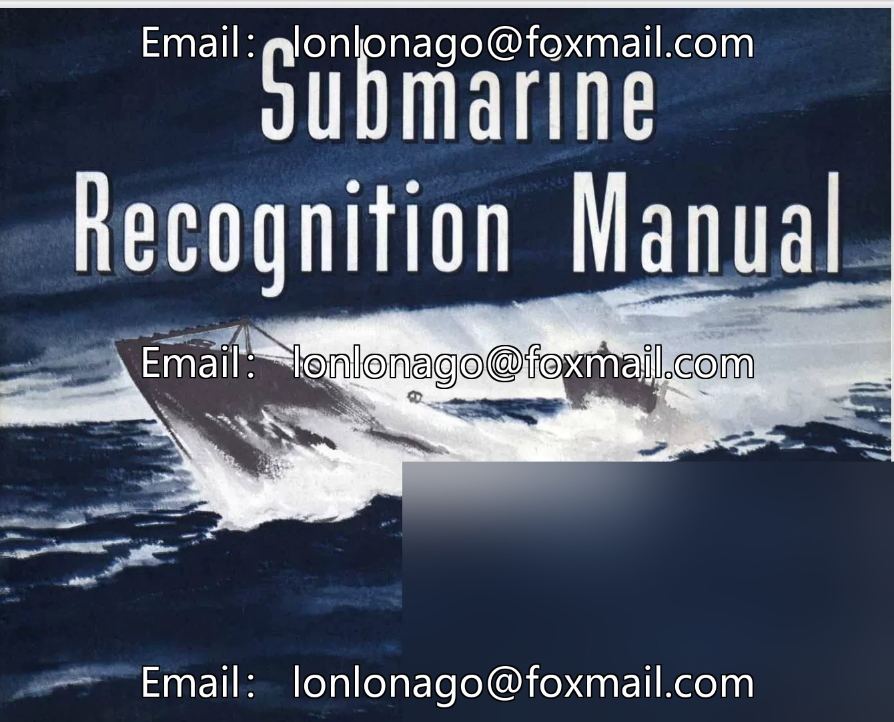
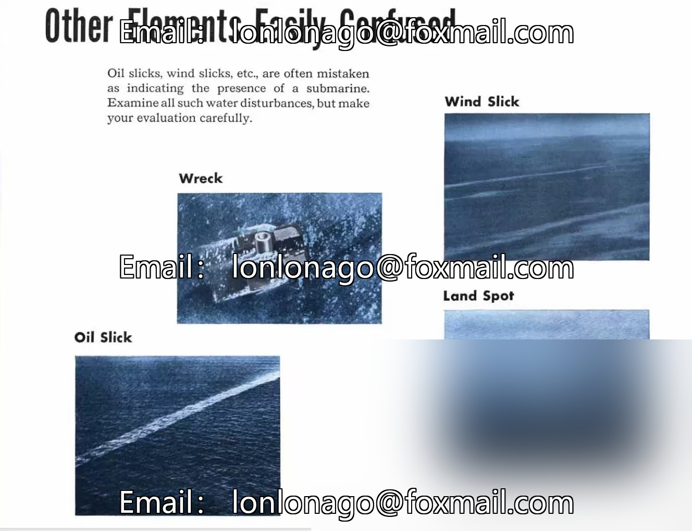
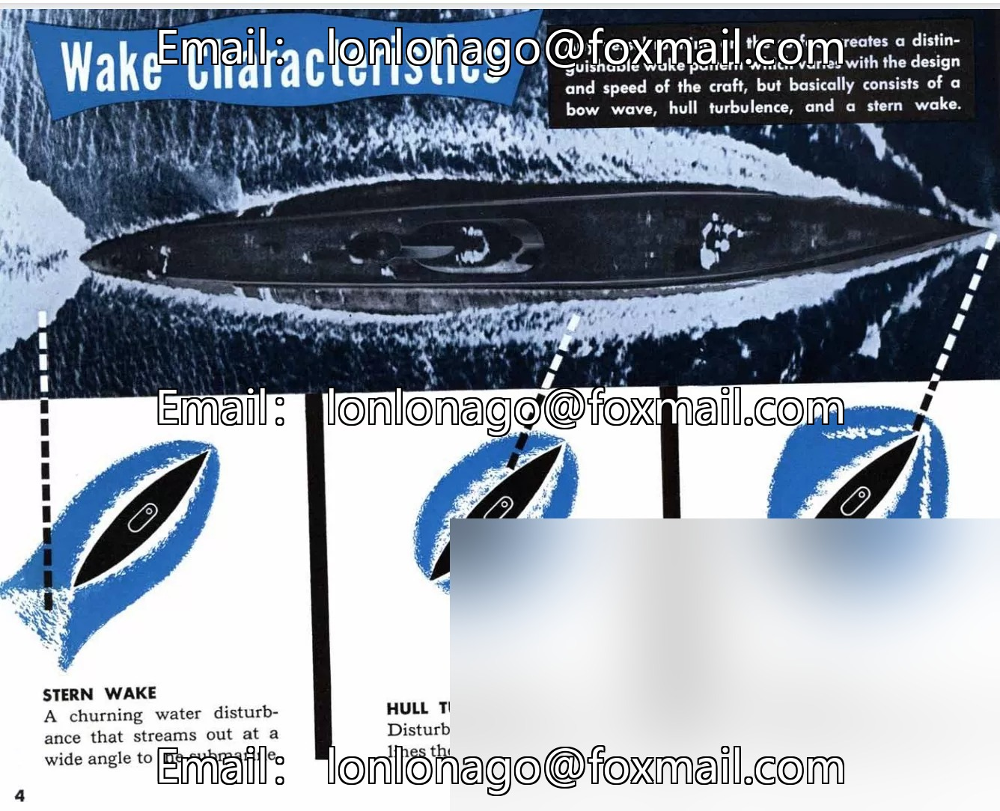
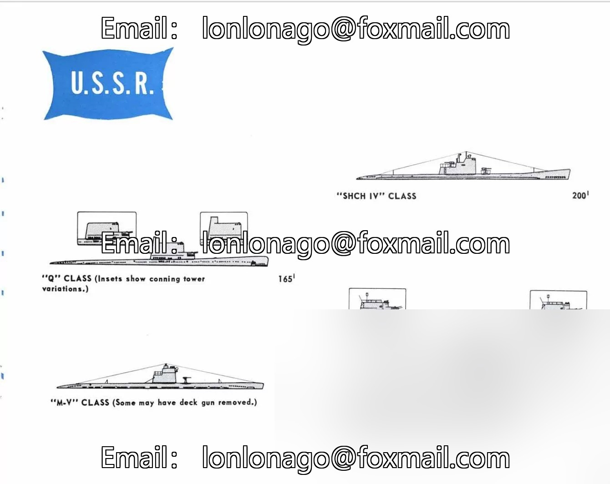

# The Navy's published *Submarine Identification Manual* (NAVPERS 1001)

## Body

The *Submarine Identification Manual* published by the U.S. Navy (NAVPERS 10011) belongs to military training standard documents from the WWII to the Cold War period. The following is an analysis of key information:

Nature and purpose

The manual is a professional textbook for U.S. military naval personnel (NAVPERS series), used for training officers and soldiers to quickly identify enemy and friendly submarines.

Submarine contour features (command tower, vessel ratio, periscope style)

Nationality identifier (such as Japanese Imperial Type submarine vs German Imperial U-type submarine)

Aerodynamics judgment (telescopic mirror depth, throttle pipe status)

Historical background

NAVPERS number indicates it is an official document issued by the Bureau of Naval Personnel, widely used during World War II for anti-submarine operations on the Pacific battlefront during World War II, and may be updated and iterated in the early Cold War period.

Cover design (blue and white main colors, sea wave elements) highlights actual combat scenarios to enhance visual memory for recognition training.

Technical details speculation

Comparison between submarine illustrations of a large and a small may suggest the teaching focus (such as distinguishing supply submarines from attack submarines).

Manual or practical tools including silhouette comparison charts, speed estimation tables, etc. (a simplified version similar to *Jane's Fighting Ships*).

The submarine recognition manual (NAVPERS 10011) was published by the United States Navy as a war-to-cold war naval training standard document, aimed at training personnel to quickly identify enemy and own submarines, covering submarine contour features, nationality identification, navigation judgment and historical background.

<!-- AI_ENRICHED -->

## Images

## Payment

Here is a pay link on Stripe ( https://buy.stripe.com/3cs8yP7sY87d0vu9AB ). Please contact me lonlonago@foxmail.com after funding $89, and I will send you a complete data files , thank you!

